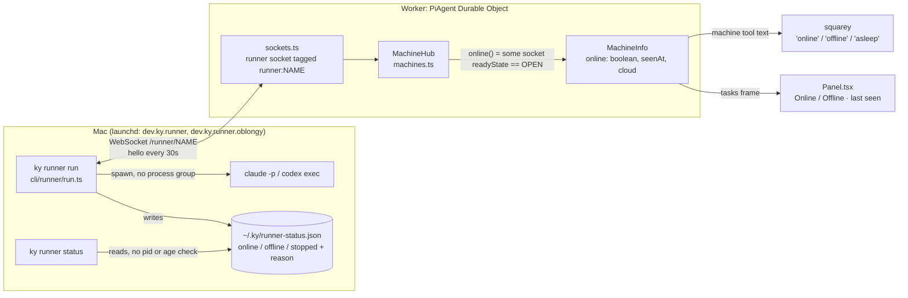
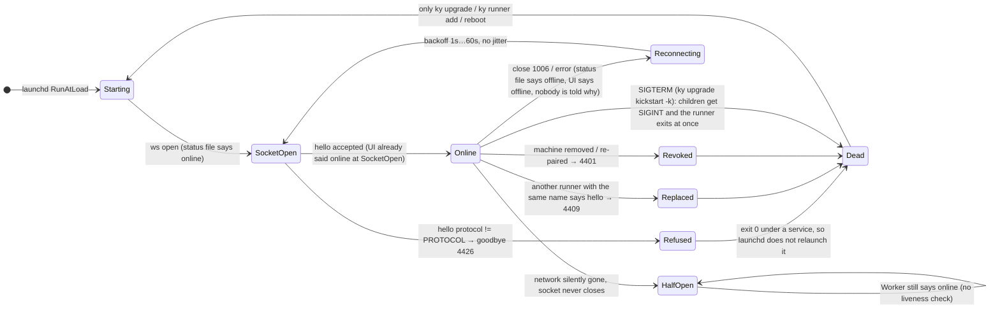
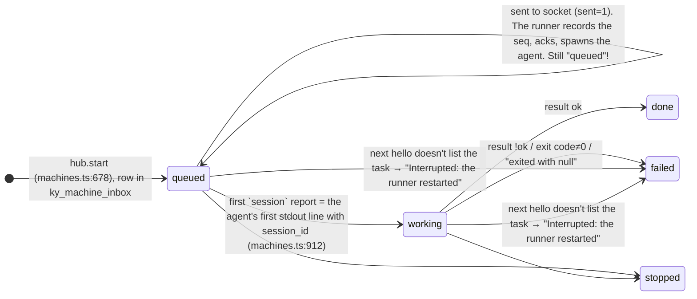
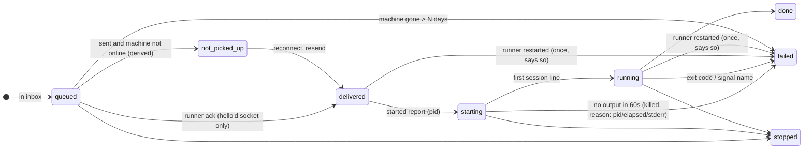

# Machine invariants: how ky connects to machines and runs tasks on them

Status: issue doc, 2026-10-15. Nothing here is implemented yet. Verification lives in
`.claude/skills/verify-ky-machines/` (see [Baseline](#baseline-2026-10-15)).

**What we want.** A machine is clearly on or off, always with a reason, and the reason is true.
Errors reach the user; nothing fails silently. You send a task, the machine you asked for picks it
up quickly, and it runs with a live view.

**What we have.** Three separate views of "is this machine up" disagree with each other. "Online"
only means a socket is open. A task is "queued" until the agent's first output line, so a started
task that hangs looks the same as one that never left the inbox. Protocol skew kills the runner on
purpose and the UI never says why.

---

## 1. How it works today

### Who decides "online"

There are three sources of truth, and none of them checks the others:

| Surface | What "online" means | Code |
|---|---|---|
| Runner status file / `ky runner status` | The runner's own socket fired `open` (written before the hello is accepted). The file is never checked for a live pid or its age. | `cli/runner/run.ts:180-184`, `cli/runner/commands.ts:284-289, 335-346` |
| Worker `MachineHub.online()` | Any socket tagged `runner:<name>` has `readyState === OPEN`, including one that hasn't said hello yet. There is no heartbeat check: the 30 s hello is never timed on the Worker. | `src/machines/machines.ts:362-364`, `src/sockets.ts:460-461` (the comment says "online once it says hello", but the code doesn't do that) |
| Web UI | `MachineInfo.online` from the above. There is no reason field, so an offline computer always shows `Offline · last seen N min ago` and the hint "Start it there with `ky runner run`". | `src/ui/Panel.tsx:1135-1156, 1402-1414` |
| Agent (squarey) | The same boolean, as "online/offline". The task status words come from the task feed. | `src/machines/machines.ts:1057-1063` |

### Machine connection states (implicit today)

Nothing stores these states; they're inferred from the code paths.

The cloud machine adds a derived `asleep | waking | running` (`machines.ts:392-396`). `waking` only
means "not connected and has work". There is no deadline and no progress, and no reason when a
start fails (`src/cloud.ts`, `START_WITHIN_MS` 3 min, logged with `console.log` only).

### Task lifecycle (as the user and squarey see it)

So:

* **acked**, **process spawned** and **agent alive** all display as `queued`. This is exactly
  incident 5.
* An ack never times out. An unacked command is only resent when something calls `#deliver` again:
  a new enqueue, or the runner's 30 s hello (`machines.ts:440-520, 870-901`). On a healthy
  connection that bounds resend at about 30 s. After a disconnect it's the reconnect backoff,
  up to 60 s. The token or creds retries are in memory and lost on eviction (challenge
  correction).
* After `#act` there is no watchdog of any kind: no start timeout, no first-output timeout, no idle
  timeout and no overall timeout (`cli/runner/runner.ts:441-501`, `cli/runner/tasks.ts:185-245`).

---

## 2. Today's incidents, mapped to code

| # | What happened | Mechanism in code |
|---|---|---|
| 1 | **Worker ahead.** PR #92 bumped `PROTOCOL` 3→4 and deploy.yml shipped it on merge. The brew runner (0.2.6, protocol 3) got `goodbye` and exited for good. The UI showed it as just offline. | The Worker deploys on every push to main (`.github/workflows/deploy.yml`); the runner only ships on a `v*` tag (`release.yml`). The only guard is `test/invariants/runner-wire.test.ts`, which forces a bump but nothing about order. On a hello with `protocol ≠ PROTOCOL` → `goodbye` + close 4426 (`src/sockets.ts:576-581`, `runner-protocol.ts:319-327`). The runner's FATAL map → `process.exit(service ? 0 : 1)` (`cli/runner/run.ts:137-142, 194-201`). The plist has `KeepAlive.SuccessfulExit=false` (`service.ts:71-75`), so it stays dead. The Worker keeps no record of the refusal: the UI says `Offline · last seen…` and suggests `ky runner run` (`Panel.tsx:1402-1414`), which would just be refused again. |
| 2 | **Runner ahead.** The `oblongy` deployment shares the binary. After `brew upgrade` its runner spoke 4 to a Worker that spoke 3 and was refused. Log: `12:23:06 ky said goodbye: ky speaks runner protocol 3 and this runner speaks 4`. | `restartRunner` restarts **every** loaded runner instance on the computer (`cli/runner/commands.ts:395-408`), but `ky upgrade [target]` only deploys one Worker (`cli/commands.ts:90-107`). So upgrading squarey restarts oblongy's runner onto a protocol its Worker doesn't speak yet. The equality check means there's no overlap window. |
| 3 | **Orphans after restart.** Three `claude -p` children of the old runner were reparented to PID 1 and sat for 75+ min while the new runner re-ran the tasks. | SIGTERM handler: `runner.shutdown()` (SIGINT to each child) then `process.exit(0)` straight away (`run.ts:224-230`). The SIGKILL escalation is an `unref`'d 5 s timer in the dying process (`tasks.ts:237-240`), so it never fires. Children are spawned without `detached` or a process group (`tasks.ts:203`), there is no pidfile, and nothing reaps leftovers on startup. A child that ignores or is blocked on SIGINT (the hung `claude`, below) survives. The new runner's hello lists no active tasks, so the hub fails them as "Interrupted: the runner restarted" (`machines.ts:875-890`). squarey then re-sent them, giving new `start claude` lines without `resume` at 12:24:21-28, because no session id was ever reported. The restart itself isn't logged: `connected` at 12:23:05 and again at 12:24:04 with no line between. |
| 4 | **Hung agent, status still online.** After 0.2.7 every `claude` blocked in `openat()`, wrote no transcript, used about 0.2 s CPU, and ended `exit null`. `ky runner status` said online. | There is no start or first-output watchdog (above). Exit by signal surfaces as "claude exited with null." because only `code` is passed; the signal name is lost (`tasks.ts:222-224`, `runner.ts:459`). Runner status only reflects the socket, never task health. The root cause is still unknown; see the hypotheses below. |
| 5 | **Misdiagnosis.** squarey said m-6329 "is still waiting in the queue and hasn't started… restart the runner". | `queued` covers inbox, sent, acked, spawned and hung (lifecycle above). The machine tool can only report what the feed holds (`machines.ts:1057-1063, 1217-1230`). |
| 6 | **Frequent silent `1006` reconnects.** `~/.ky/runner.log`: 119 disconnects / 130 connects; oblongy: 86 / 95. | Each one is logged without a date (`run.ts:63-65` logs `HH:MM:SS` in UTC only) and written to the status file. Nothing is counted or surfaced. Many drops happen **at the same second on both deployments** (17:08:35, 18:37:35, 18:54:05, 19:06:05, ~20:10), which points to the Mac's network, sleep or Cloudflare's edge rather than either Worker. The UI flips to offline during each blip because there's no debounce, and back once the runner says hello. |

**Hypotheses for incident 4** (untested; `verify-ky-machines` has a `hang` probe that covers the
symptom, whatever the cause):

1. *A macOS privacy (TCC) prompt.* `runner.json` has `"chrome": true`, so `claude` gets `--chrome`,
   which touches Chrome's native-messaging and app-data paths. Under launchd, the responsible
   process for a TCC check is the `ky` binary. `brew upgrade` swapped that binary, which can
   invalidate an earlier grant. A pending consent blocks `open()` in the kernel, which fits
   `__openat_nocancel`, no CPU, and "works by hand from Terminal" (Terminal has its own grant). It
   would also clear on its own once the prompt was answered or timed out. To test: run
   `log stream --predicate 'subsystem == "com.apple.TCC"'` while the launchd runner starts a task,
   then check System Settings › Privacy & Security for `ky`.
2. *A FIFO or lock opened with no counterpart* (Chrome's native host socket, `~/.claude.json`
   lock) while 3-4 `claude` processes start in the same second. The 12:23:06 log shows three starts
   in one second.

---

## 3. Invariants

Each one is meant to be testable. The **probe** column says which `verify-ky-machines` probe
checks it today; "—" means it needs a new probe or a unit test.

| # | Invariant | Probe |
|---|---|---|
| **M1** | **One source of truth.** The Worker computes one `MachineStatus` per machine: `{ connection: online \| reconnecting \| offline \| outdated \| refused \| asleep \| waking, reason, since }`. The UI, squarey and `ky runner status` (which asks the Worker, and falls back to the file only when the Worker can't be reached, saying so) all render that, and no surface derives its own. The user's intent (`on/paused/off`) stays separate. | skew, offline |
| **M2** | **Every state has a reason that is true and actionable.** "Offline: no runner since 12:30 (last close 1006)". "Outdated: runner protocol 3, ky speaks 4. On the Mac: `brew upgrade ky && ky upgrade`". "Silent: no frame for 75 s". The fix hint matches the reason; we never suggest `ky runner run` for an outdated runner. | skew |
| **M3** | **Online means proven alive.** A hello was accepted (protocol OK, paired) **and** the last frame arrived within 2 × keepalive + slack (≤ 75 s). A socket that's open but hasn't said hello, or has gone silent, is not online. | skew, halfopen |
| **M4** | **Blips are debounced, outages aren't.** A reconnect within ~5 s doesn't flip the UI to offline. Every reconnect is counted, and flapping (e.g. > 6/h) shows as degraded with the count. | offline, live |
| **M5** | **Pickup latency bound.** On an online machine: enqueue → runner ack ≤ 1 s p95, and ack → agent spawned ≤ 1 s p95. A command not acked within 5 s is resent; one not acked within 30 s puts the task in `not picked up: <reason>`. | latency |
| **M6** | **The task lifecycle tells queued, started and running apart.** `queued` (in inbox) → `delivered` (acked) → `starting` (process spawned: pid, at) → `running` (first agent output) → `done/failed/stopped`. The runner sends a `started` report at spawn. squarey and the UI read the same states. | hang, latency |
| **M7** | **A started task proves it is alive within N s, or fails loudly.** No stdout within `N` (e.g. 60 s for claude, configurable) → kill (SIGINT, then SIGKILL) and fail with a reason: pid, elapsed, CPU time, stderr tail and the signal. (The runner can't see a child's CPU time today, so a mid-run idle check is out of scope; the challenge pushed back on it.) | hang |
| **M8** | **No silent failure on the task path.** Spawn error (ENOENT), exit by signal (named), non-zero exit, unparseable output, a delivery that keeps failing, a token or creds failure past its retries: each one ends or annotates the task with a reason, and logs a line with a date. | hang |
| **M9** | **Protocol skew is caught before deploy.** A deploy whose `PROTOCOL` is newer than the newest *released* runner's is refused (or only allowed with an explicit flag). Order: release the runner first, then deploy the Worker. | — (CI) |
| **M10** | **Skew overlap.** The Worker accepts `[PROTOCOL-1, PROTOCOL]` for at least one release, and the runner speaks a range. Equality-only makes every bump an outage for someone. A range is only safe if the frames really stay compatible; otherwise, prefer M9 ordering plus M11. | skew |
| **M11** | **Skew is explained, and recovers by itself.** An outdated runner doesn't exit for good: it stays in a slow probe (e.g. every 10 min, and on SIGHUP) while the status says `outdated` with the fix. The Worker remembers the last refused hello (protocol, version, at), so the UI can show it after the socket closes. | skew |
| **M12** | **No orphans across a restart or exit.** Agents run in their own process group. On SIGTERM or a fatal exit, the runner signals the group, waits up to K s, SIGKILLs the group, **then** exits. The next runner reaps leftovers from a `{task, pgid, started}` record in its state dir, and kills only when the process identity still matches; a bare pid can be reused (challenge correction). | restart, live |
| **M13** | **A restart doesn't silently lose or duplicate work.** A task interrupted by a restart fails exactly once with the reason, and the user resumes it explicitly. It never runs twice concurrently, and an orphan never keeps working on it. Both challengers rejected auto-resume: it duplicates side effects, and while M12 is unfixed it would put two agents on one session. The runner's delivery is **at-most-once**: a crash between record and act loses the command (`runner.ts:227-243`). State that, and make it visible (M17). | restart |
| **M14** | **Each deployment is isolated.** Each runner instance (one per Worker) has its own state dir, status, handled-seqs file and service. `ky upgrade X` restarts only X's runner, and only after X's Worker speaks the binary's protocol. One deployment's skew never affects another's. | — (unit), live |
| **M15** | **Local status is honest.** `ky runner status` checks that the pid is alive and the status is fresh. Log lines carry a full timestamp. Shutdowns and restarts are logged. | live |
| **M16** | **Cloud wake has a deadline and progress.** `waking` shows what step it's on (starting container → runner connected) and a deadline (`START_WITHIN_MS`). Missing the deadline, or a deploy without containers (no Workers Paid), shows a reason rather than `asleep` forever. | cloud |
| **M17** | **An ack means the runner acted, or it says why it didn't.** Seqs are scoped to the object that numbered them. A reset Durable Object (new storage, same URL) numbers from 1 again; the runner's `handled-*.json` then acks and silently drops every new command, and the hub deletes the inbox row (`handled.ts:16-18`, `runner.ts:240-243`, `machines.ts:909`). Today the only guard is a comment telling you to delete the file by hand. *(from the challenge)* | — |
| **M18** | **Commands only go to a socket whose hello was accepted, and a send that was never acked can be undone.** `#send` writes to any OPEN socket, including one before its hello (`machines.ts:565-566`), and sets `sent=1`. If that socket closes before an ack, `move` refuses (`machines.ts:712`) and `stop` waits for a result that never comes. Similarly, only a *hello* closes the machine's other sockets (`sockets.ts:599`, `#replaceRunner`), so until then two runners' reports both reach `hub.onReport` under one name. Ignore frames from a socket that isn't the machine's current one. *(challenge)* | — |
| **M19** | **The runner notices a dead socket too.** The Worker never answers a hello, so after a Mac sleeps and wakes, or a NAT drops the connection, the runner buffers hellos into a dead TCP socket until the kernel gives up. All that time its status file says online (`run.ts:170-184`). Two unanswered keepalives → reconnect. *(challenge)* | halfopen (Worker side only) |
| **M20** | **Only an explicit decision ends the service.** A hand-run `ky runner run` (the UI's own hint) replaces the service's socket. The service's runner gets 4409 → exit 0, and launchd never relaunches it (`sockets.ts:543-556`, `run.ts:137-142`). Any 401 on a failed connect is treated as REVOKED and also exits for good (`run.ts:149-160`), so a transient edge or Access 401 kills it permanently. *(challenge)* | — |
| **M21** | **Open work on a machine that never comes back resolves.** Nothing ages out `queued`/`working` tasks or pending stops for a machine that's gone for days. `busy()` keeps a cloud machine `waking` indefinitely (`machines.ts:856-858`). There should be a bound, or an explicit give-up path that names the machine. *(challenge)* | — |

---

## 4. Gaps against the invariants

| Invariant | Holds today? | Gap, with code |
|---|---|---|
| M1 | No | Three independent sources (§1 table). `MachineInfo` has no `reason` (`src/protocol.ts:27-45`). |
| M2 | No | No reason anywhere on the Worker side. The goodbye reason only goes to the runner's log. The fix hint is hard-coded to `ky runner run` (`Panel.tsx:1402-1414`). |
| M3 | No | `online()` = socket OPEN (`machines.ts:362-364`). It counts sockets before their hello (`sockets.ts:460`), and a silent half-open socket stays "online" until Cloudflare notices. |
| M4 | No | No debounce, no counter. Reconnects only appear in the runner log. |
| M5 | Mostly (latency) / No (resend) | Delivery is immediate when online (see baseline). There's no ack timeout: resend waits for the next hello (≤ 30 s) or the next enqueue. `#retry` only covers token or creds failures (`machines.ts:463-488`). |
| M6 | No | Statuses are `queued \| working \| done \| failed \| stopped` (`automations/contract.ts:114-119`). `working` only comes from the first `session` report (`machines.ts:912`). The Panel calls open tasks "running" even when they're queued (`Panel.tsx:1149-1156`). |
| M7 | No | No watchdog at all (`runner.ts:441-501`). |
| M8 | Partly | A signal exit becomes "exited with null" (`tasks.ts:222`). A spawn `error` only appends to stderr (`tasks.ts:226-228`). Unparseable lines are dropped silently (`claude.ts:113`). `step` and `ack` reports made while disconnected are dropped (`runner.ts:224`). |
| M9 | No | deploy.yml deploys on every merge and doesn't know which runner was released. |
| M10 | No | Strict equality (`runner-protocol.ts:319-327`). |
| M11 | No | The runner exits 0 so the service won't relaunch it (`run.ts:194-201`). The Worker forgets the refusal. |
| M12 | No | See incident 3. The baseline reproduces it. |
| M13 | No | The new hello fails every open task as "Interrupted" (`machines.ts:875-890`). There's no auto-resume, and an orphan may still be working. |
| M14 | Partly | State dirs, status files and labels are already split (`system.ts:135-155`). `restartRunner` restarts all instances (`commands.ts:395-408`), and `ky upgrade` restarts runners even when the Worker is already current (`cli/commands.ts:97-100`). |
| M15 | No | The status file isn't checked for a live pid or its age. Logs have `HH:MM:SS` in **UTC** only (`run.ts:63-65`), while `ky runner status` and launchd use local time. SIGTERM isn't logged. |
| M16 | Partly | `waking` is derived and has no deadline in the UI. Container-start failures are `console.warn`ed and retried by the alarm (`src/cloud.ts:187-190, 332-347`), but they never become a machine reason. |
| M17 | No | Documented hazard only (`handled.ts:16-18`). |
| M18 | No | See the invariant. The bench's "never listed online pre-hello" didn't sample the window. |
| M19 | No | No reply frame. The `halfopen` probe only models the Worker's view, not a runner sending into a dead peer. |
| M20 | No | REPLACED and any HTTP 401 are both permanent exits under launchd. |
| M21 | No | No expiry anywhere. |

---

## 5. Simplification opportunities

1. **One `MachineStatus` on the Worker** replaces `online: boolean` plus `cloud: asleep|waking|running`
   plus the runner's own status file. Panel, squarey's `upness()` and `ky runner status` become
   renderers of one value. This deletes `upness`, `#cloudState`, `offlineStatus` and
   `CLOUD_STATUS` as separate logic.
2. **Use the hello we already send as the heartbeat, with no new state.** `seen_at` is already
   written on every hello (`machines.ts:872`). M3 becomes `online = accepted-hello socket OPEN &&
   now - seen_at < 75 s`, computed in `machines()`. One callback registered with the existing
   `Scheduler` (the DO's single alarm is already in use, `automations.ts:178-189`; don't call
   `setAlarm` directly) re-broadcasts at `seen_at + 75 s`. The runner also needs to notice a dead
   socket (Fable): the Worker answers a hello with a one-word reply, or uses CF auto-response, and
   the runner reconnects when two go unanswered.
3. **"Not picked up" is derived at read time, not timed.** Ack p95 is 16 ms, so an unacked command
   really means a dead socket, which (2) plus resend-on-hello already handles. Show "sent, not
   picked up" when `sent=1 && !online`. Clear `sent` when the socket it went to closes before an
   ack, so that `move` and `stop` work again (`machines.ts:712, 746-767`).
4. **One `started` report at spawn**, and statuses derived from inbox, ack, started, first output
   and result. This removes the "session means working" coupling.
5. **The runner owns its children.** `spawn(..., { detached: true })` plus kill the group, a
   pidfile, and a bounded shutdown before `process.exit`. It's about 30 lines and removes a whole
   class of orphan bugs.
6. **Protocol as a range, with outdated as a state.** Replace the FATAL-exit-0 dance (and the
   launchd `SuccessfulExit` coupling) with "stay up, probe slowly, report outdated". `REVOKED` and
   `REPLACED` can stay fatal.
7. **`ky upgrade X` restarts only X's runner.** This is a filter, not a new endpoint:
   `ky upgrade` already knows the URL it deployed (`cli/commands.ts:90-107`), and each runner
   instance's `settings.url` (`cli/runner/commands.ts:398`). Restart only the runners whose URL
   matches.
8. **Ack-without-act needs an epoch, not a manual step.** Put a per-object id (created once in DO
   storage and sent in the hello reply, or with each command) in the `HandledSeqs` owner key, so a
   reset object can't collide with seqs the runner already recorded (`handled.ts:16-18`).

---

## Baseline (2026-10-15)

Run with `node --experimental-strip-types --no-warnings .claude/skills/verify-ky-machines/bench.ts all --runs 10`.
This uses the real Worker (`wrangler dev` via `test/harness`), the real `ky runner` and fake `claude`, with a TCP proxy in
between. Total wall time is about 2.5 min. Raw numbers are in `test-results/machines-bench/results.json`.

### Timings

| Probe | Measure | Value |
|---|---|---|
| latency (10 runs) | runner connect → listed online | 1148 ms |
| | prompt → task row exists (includes faux model turn) | p50 551 / p95 558 ms |
| | row → runner ack | **p50 7 / p95 16 ms** |
| | row → agent spawned | p50 126 / p95 140 ms |
| | row → `working` | p50 127 / p95 141 ms |
| | row → first step visible | **p50 128 / p95 143 ms** |
| | row → done (fake agent, 200 ms of work) | p50 348 / p95 401 ms |
| restart | SIGINT → runner exits | 4 ms (does not wait for its child) |
| | relaunch → online | 319 ms |
| skew, Worker ahead | launch → runner exits for good | 656 ms (exit 1 in the foreground; under launchd it's 0, so no relaunch) |
| skew, runner ahead | hello → close 4426 | 333 ms |
| hang | row → spawn | 52 ms |
| | stop → `stopped` (agent ignores SIGINT) | 5051 ms (the SIGKILL timer fires because the runner stays up) |
| offline (clean cut) | cut → UI offline | 27 ms |
| | network back → online | 2070 ms (1 s backoff + reconnect) |
| | network back → task queued while offline is done | 2434 ms |
| halfopen | silence → UI offline | **never (still online after 70 s)** |
| cloud (local fake container host) | row → waking shown / runner online / done | 0 / 698 / 1033 ms |

The happy path is fast. Pickup takes milliseconds and the first output arrives in about 140 ms, so
latency is not where the problem is. Everything that goes wrong is about **truth and recovery**.

### Verdicts

| Verdict | Check | Invariant |
|---|---|---|
| HOLDS | pickup p95 < 1 s (16 ms) | M5 |
| HOLDS | first visible output p95 < 2 s (143 ms) | M5 |
| **GAP** | no orphan 6 s after its runner exits: pid still alive, reparented to launchd | M12 |
| **GAP** | a task interrupted by a restart resumes: it fails "Interrupted: the runner restarted" | M13 |
| **GAP** | Worker ahead: the user sees *outdated*, not just offline. The row has no reason field (`name,online,seenAt,active,state,note,facts,login,cloud,sandbox`) | M2, M11 |
| HOLDS | runner ahead: refused with 4426 and a reason, but only the runner sees it | M2 (runner side only) |
| HOLDS* | runner ahead: never listed online before its hello was accepted. *The bench didn't catch the window, but it is real: `sockets.ts:460-461` tags the socket at upgrade and `online()` counts it (`machines.ts:362-364`), and `#send` will deliver to it. Treat this as untested, not as holding. | M3 |
| **GAP** | runner ahead: the user sees why | M2 |
| **GAP** | a spawned agent shows as started: still `queued` after 45 s | M6 |
| **GAP** | a silent agent fails loudly within 45 s: still `queued`, and `ky runner status` says online | M7 |
| HOLDS | a stop ends a hung agent (while the runner stays up) | M8 |
| HOLDS | clean cut → offline within 2 s; back within 5 s; a task sent while offline runs when it's back | M4, M5 |
| **GAP** | a runner silent for 60 s+ (half-open) is shown offline: still online at 70 s | M3 |
| HOLDS | cloud wake runs a task (fake host only) | M16 (partial) |
| SKIP | **live** cloud wake: this account has no Workers Paid, so it can't run containers (`ky upgrade` on squarey reported it). The fake-host probe covers the hub logic only. | M16 |

### Live machine (`live.sh`, read-only, 2026-10-15)

| | default (`squarey`) | `oblongy` |
|---|---|---|
| status file | online, pid 68347 alive | online, pid 68350 alive |
| launchd | running, last exit 0 | running, last exit 0 |
| Worker manifest GET | 200 in 0.6–0.9 s | 200 in 0.46–0.9 s |
| 1006 disconnects / connects / goodbyes | 119 / 130 / 1 | 86 / 95 / 1 |
| restarts (connect with no disconnect before it) | 9 | 8 |
| agent `exit null` | 6 | 0 |
| orphaned agents now | none | none |

---

## 6. Gap challenge (2026-10-15)

Two read-only reviewers got this doc and the code, and were asked for missing invariants, failure
modes, overstated claims and simplifications:

- **Fable 5.1** (Claude Code subagent)
- **GPT-6 Luna** via Pi. The brief asked for **GPT-6 Astra**, but this ChatGPT-linked Codex account
  refuses it ("not supported when using Codex with a ChatGPT account"), and so does GPT-6 Sol. The
  Bedrock route has no AWS credentials. GPT-6 Luna (`--thinking high`) was the nearest model that ran.

I checked every adopted point against the code before merging it.

**Merged:**

| From | Point | Where it went |
|---|---|---|
| Fable | A reset object renumbers seqs from 1, and the runner silently acks and drops them (`handled.ts:16-18`) | new **M17** |
| Fable, Luna | Pre-hello sockets receive commands; `sent=1` to a dead socket blocks `move` and `stop`; reports aren't fenced to the current socket | new **M18** |
| Fable | The runner has no liveness check of its own after sleep/wake (no reply to hello) | new **M19** |
| Fable | A hand-run runner (the UI's hint) replaces the service, which then exits for good; any 401 is treated as REVOKED and exits for good | new **M20** |
| Fable, Luna | Nothing resolves open work on a machine that never returns; the inbox is unbounded | new **M21** |
| Luna, Fable | Delivery is at-most-once at the runner (record → ack → act); state it | **M13** |
| Both | Don't auto-resume; fail once and let the user resume | **M13** reworded |
| Luna | A pidfile alone is unsafe because pids get reused; check identity | **M12** |
| Both | The child-CPU idle check isn't observable today | **M7** trimmed |
| Fable | `seen_at` is already the heartbeat; the DO's alarm belongs to `Scheduler` | §5.2 |
| Fable | URL filter instead of `GET /runner/version` | §5.7 |
| Luna | The resend bound is the reconnect backoff (≤ 60 s), not 30 s | §1 lifecycle |
| Luna | A protocol range is only safe with compatible frames | **M10** caveat |
| Fable | Logs are UTC; the bench's "HOLDS" for pre-hello and M10 were overstated | §4 and baseline, corrected |
| Luna | Cloud failures are `console.warn`ed and retried, not just logged | **M16** gap |

**Rejected:**

| From | Point | Why |
|---|---|---|
| Luna | Handled-seq cache (1,000) eviction lets an old command run twice | The hub deletes a row once it's acked (`machines.ts:909`), so only an *unacked* command can come back, and only a few are ever in flight. That makes it theoretical. M17 covers the real seq hazard. |
| Fable | `ky runner add` reports success at socket open, before the hello | It already requires the runner to *stay* online for a while, precisely because a refused pairing closes right after it opens (`cli/runner/commands.ts:9-13`). It's mostly mitigated, and M3 closes the rest. |
| Fable | A blocking `spawnSync` on every hello (`facts.ts:69`) | It only runs for an agent last seen *missing*, and the ENOENT comes back in milliseconds. Noted, but not an invariant. |
| Luna | M14 overstates isolation | The doc already marks M14 as **Partly** and names `restartRunner`. |
| Luna | Clock-jump-robust deadlines | Workers' `Date.now()` is server time. The only exposed client clock is Panel's "N min ago", which is cosmetic. Revisit if timeouts move to the runner. |
| Fable, Luna | Drop M1 (`ky runner status` asking the Worker) | Kept in a narrower form: locally, `ky runner status` checks pid and age (M15) and *adds* the Worker's view when it can reach it, labelled as such. Not dropped, because incident 4 was exactly a local "online" lie. |

**Accepted as "not worth it yet":** M4's flap counter (a Panel debounce is enough); M10's range
before M9/M11 exist; step-by-step cloud wake progress (a deadline plus a reason is enough, and this
account can't run containers anyway); and a general ack-alarm framework (deriving "sent, not picked
up" at read time is enough).

---

## 7. Proposed fix order

Each step is small enough for one PR, and is checked by the probe named. The order puts first what
stops the system lying or losing work today, then what stops the next deploy from breaking it.

| # | Fix | Invariants | Code | Probe flips |
|---|---|---|---|---|
| 1 | **Orphan-proof shutdown.** Detached process group, kill the group, bounded wait before `process.exit`, reap from a `{task,pgid,started}` record. Must land before anything that re-runs work. | M12, M13 | `tasks.ts:203, 237-240`, `run.ts:224-230` | restart |
| 2 | **Started + watchdog + named failures.** A `started` report at spawn (`delivered` derived from ack until then), no session within 60 s → kill and fail with pid/elapsed/stderr tail, pass the signal name, surface spawn errors. | M6, M7, M8 | `runner.ts:441-501`, `tasks.ts:222-228`, `machines.ts:903-920, 1057-1063` | hang, latency |
| 3 | **Honest online + reason.** Online = accepted hello and `seen_at` < 75 s; commands only to hello'd sockets; ignore stale sockets; store the last close or refusal; `MachineInfo.reason`; the Panel hint matches the reason; the runner reconnects after two unanswered hellos. | M1-M3, M18, M19 | `machines.ts:362-388, 565`, `sockets.ts:460, 576-603`, `Panel.tsx:1402-1414`, `run.ts` | halfopen, skew |
| 4 | **Ack means acted.** An object epoch in the `HandledSeqs` owner key; at-most-once stated, with the loss visible. | M17 | `handled.ts`, `runner.ts:227-258`, hello | — (new probe: reset the DO) |
| 5 | **Skew without an outage.** `deploy.yml` refuses a `PROTOCOL` newer than the latest `v*` release; OUTDATED and transient 401 → slow probe instead of exit 0; REPLACED by a same-host runner is not permanent; `ky upgrade X` restarts only runners whose URL is X's. | M9, M11, M14, M20 | `run.ts:137-201`, `cli/runner/commands.ts:395-408`, `cli/commands.ts:90-107`, `deploy.yml` | skew |
| 6 | **Local truth.** `ky runner status` checks pid and age, and adds the Worker's view; full ISO timestamps; shutdown and restart logged; reconnects counted. | M4, M15 | `run.ts:63-65, 224`, `cli/runner/commands.ts:280-346` | live.sh |
| 7 | **Nothing open forever.** "Sent, not picked up" when `sent && !online`; `sent` cleared when its socket dies before an ack; open tasks on a machine gone longer than N days fail with its name; the cloud gets a wake deadline and a reason. | M5, M16, M21 | `machines.ts:456-520, 712, 746-767, 856-858`, `cloud.ts` | offline, cloud |
| 8 | **Protocol range** (optional, only if bumps stay frequent after 5). | M10 | `runner-protocol.ts:319-327` | skew |

Target task lifecycle after steps 2, 3 and 7:

---

## 8. Slim plan (supersedes §7)

§3 and §7 overshoot. The baseline says latency is fine (16 ms pickup p95), and every failure today
is about truth and recovery. So this plan keeps only what fixes an incident or a measured GAP, and
it **needs no `PROTOCOL` bump**, since a bump is what caused incident 1.

**Cut or deferred, and why:**

| Item | Decision | Why |
|---|---|---|
| M1's 7-state `MachineStatus`, `ky runner status` asking the Worker | Cut | One `reason` string next to the existing `online` covers M2 at a fraction of the surface. |
| M4 flap counter | Cut | Reconnect takes about 2 s (measured); nobody acts on a count. |
| M5 ack timeout and resend | Cut | Ack p95 is 16 ms. An unacked command means a dead socket, which step 3 handles. |
| M6's new `delivered`/`starting`/`running` statuses | Cut | Mark `working` at the run's ack (hub only), and let the watchdog catch a silent start. Same user-visible truth, no contract change. |
| M10 protocol range | Cut | M11 (no fatal exit) plus the deploy gate make a bump cost minutes, not an outage. |
| M12 reaping on boot | Cut | Killing the group and waiting before exit prevents orphans; reaping only covers `kill -9` of the runner. |
| M16 wake progress | Cut | This account can't run containers. |
| M17 epoch, M19 runner-side pong, M21 expiry, M18 `sent` undo | Deferred | Real, but rare or not seen today. Revisit after step 3. |

**The plan** (one PR each, stacked in this order, each proved by its probe flipping GAP → HOLDS):

| # | PR | Change | Proof |
|---|---|---|---|
| 1 | **Runner owns its children** | `spawn(..., {detached: true})`; `interrupt` signals the group (`process.kill(-pid, …)`); shutdown awaits every child's exit (≤ 6 s, then SIGKILL the group) before `process.exit`. `tasks.ts:185-245`, `run.ts:194-230`, `runner.ts` shutdown. | `bench.ts restart`: "no orphan" HOLDS |
| 2 | **A hung start fails loudly** | Hub: on `ack` of a run, set the task `working` (read the inbox row before deleting it, `machines.ts:908-911`). Runner: a 60 s no-event watchdog per run → interrupt and `#end(..., false, "<agent> started (pid N) but wrote nothing in 60s. stderr: …")`. The exit text names the signal (`close (code, signal)`). A spawn `error` ends the task with its message. `runner.ts:441-501`, `tasks.ts:222-228`. | `bench.ts hang`: both GAPs HOLD; `latency` stays under its bounds |
| 3 | **Online is true, with a reason** | `online()` = a socket that said hello **and** `seen_at` within 75 s (`machines.ts:362-388`); commands go only to hello'd sockets (`machines.ts:565`, `sockets.ts:460`). Store the last refusal or close (`refused_protocol`, `refused_version`, `refused_at`, or the last close code) on `ky_machines`, in `sockets.ts:576-581`; add `MachineInfo.reason`; Panel shows it with a matching fix hint (`Panel.tsx:1135-1156, 1402-1414`); squarey's machine text uses it (`machines.ts:1057-1063`). One `Scheduler` callback re-broadcasts at `seen_at + 75 s`. | `bench.ts halfopen` and `skew`: the halfopen GAP and both "user sees why" GAPs HOLD |
| 4 | **Skew never kills the service** | OUTDATED and a bare 401 → log, `say("outdated"/"refused", reason)`, retry every 10 min instead of `process.exit` (`run.ts:137-201`). REVOKED (a real 4401 close) and REPLACED stay fatal. `restartRunner` restarts only runners whose `settings.url` is the deployed URL (`cli/runner/commands.ts:395-408`, `cli/commands.ts:90-107`). `deploy.yml` refuses when `PROTOCOL` on main is newer than in the latest `v*` tag. | `bench.ts skew` (runner keeps running, reconnects when fixed); unit test for the URL filter; dry-run the deploy gate |
| 5 | **Logs and local status tell the truth** | Full ISO timestamps in `log`; log SIGTERM/SIGINT and shutdown; `ky runner status` checks the pid is alive and says how old the status is (`cli/runner/commands.ts:280-346`). | `live.sh` shows dates and pid truth |
